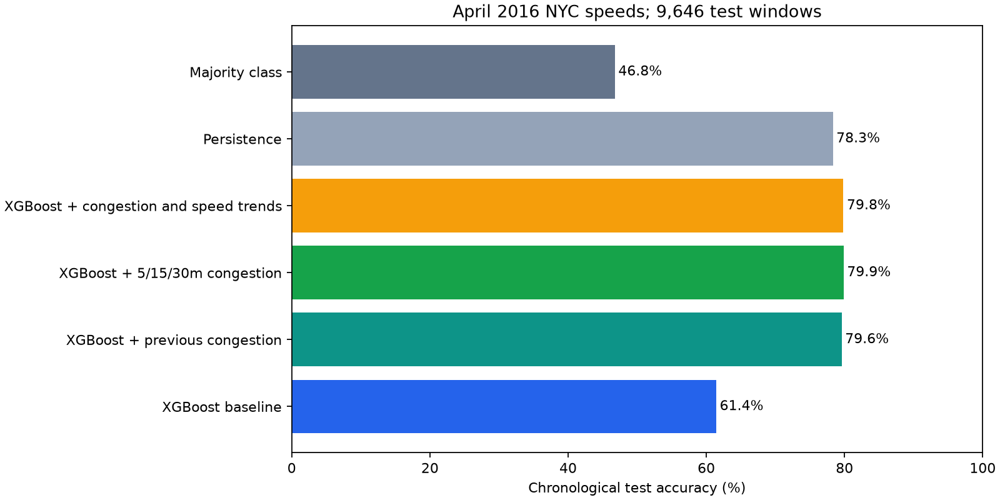

# April 2016 NYC traffic: historical congestion experiment

This experiment uses the supplied `april2016.csv.zip` DOT traffic-speed archive. It scans 1,141,383 CSV rows in chunks, selects the 10 most frequently observed links from the initial sample, and retains their first 28 days as five-minute average-speed readings. The model comparison runs on this sampled slice rather than fitting the full database.

## Held-out results

| Model | Test accuracy | Macro F1 | Validation accuracy |
|---|---:|---:|---:|
| Paper-style baseline: road, weekday, hour | 61.45% | 0.460 | 67.37% |
| Add previous congestion (exactly 5 min earlier) | 79.59% | 0.697 | 82.55% |
| Add congestion at 5, 15 and 30 minutes earlier | **79.87%** | 0.700 | 82.92% |
| Add historical congestion and speed trends | 79.84% | 0.659 | **83.03%** |
| Persistence: predict last congestion unchanged | 78.31% | **0.707** | - |

Three exact historical congestion readings gave the best test accuracy: **18.42 percentage points above the baseline**. That is 7,705 correct classifications out of 9,646 versus 5,928 for baseline. The richer speed-trend set had the best validation score, but slightly lower test accuracy. Persistence had the strongest macro F1, so accuracy alone does not tell the whole story.

## Method

The baseline uses `linkId`, weekday and hour to predict the congestion class at that five-minute observation. The DOT file does not include congestion labels, so the project derives five classes from each link's speed z-score. Per-link mean and standard deviation are fitted on the first 70% training period: z-score >= 2 is clear (0); >= 1 light (1); >= 0 moderate (2); >= -1 heavy (3); below -1 severe (4). This is a project-defined proxy, not an official DOT label.

We aggregate readings into five-minute link averages, then reindex every link to a complete five-minute clock before creating lag features. “5 minutes earlier” therefore means the exact previous five-minute bin. A missing sensor reading leaves the corresponding lag missing; that observation is removed from the shared comparison sample. All variants use the same rows: 44,322 train, 9,783 validation, 9,646 test. The split is chronological; see `run_metadata.json` for exact bounds.

Twelve XGBoost settings per feature set were selected by validation accuracy, with macro F1 breaking ties. Tree count, depth, learning rate and minimum child weight varied. The final test period did not select settings. Test predictions use features available at or before their timestamp. This is rolling one-step evaluation: readings become available as they occur, not a multi-hour prediction made once with no fresh data.

Link selection uses observation counts in the first source chunk, before the held-out period. Results apply to this sample and label proxy, not to every New York street. The earlier ~60% neural-network result came from a different project and setup, so compare them only after aligning data, labels and splits.

## Reproduce

From the extracted package directory, install `numpy`, `pandas`, `xgboost`, and `matplotlib`, then run `python train_april.py`. The archive is included under `data/april2016.csv.zip`. The script creates `april2016_results/` with the sampled observations, predictions, metrics, validation search, fitted label references, run metadata, chart, and trained XGBoost models. The recorded run used NumPy 2.3.5, pandas 3.0.1 and XGBoost 3.4.1.
